# RiskGuard AI

An end-to-end ML pipeline that tries to predict whether a stock's next week will be low, medium or high risk, and then tests that prediction honestly. It fetches prices, validates them, trains, evaluates against simple baselines, saves a versioned model, and serves it through a FastAPI service with a small dashboard.

**The headline result is a negative one, and the repo is built to show it:** on six large US tech stocks, the model does not beat two one-line baselines.

Started as a course project (AI-321, GIK Institute) and later rebuilt around a proper evaluation.

## Results

Task: classify the volatility of the next 5 trading days as Low / Medium / High, for AAPL, MSFT, GOOGL, AMZN, TSLA and NVDA.

Evaluation: walk-forward over five consecutive 90-trading-day windows (22 Jan 2025 to 4 Nov 2026, 540 predictions per window, 2,700 in total). Each window is predicted by a model trained only on data that ends 5 trading days before the window starts.

| Window | Gradient boosting (served) | Logistic regression | Persistence baseline | Majority baseline |
|---|---|---|---|---|
| Jan – May 2025 | 46.3% | 47.0% | 47.2% | 40.4% |
| Jun – Oct 2025 | 56.5% | 58.3% | 53.3% | 54.3% |
| Oct 2025 – Feb 2026 | 47.0% | 49.4% | 45.6% | 42.8% |
| Feb – Jun 2026 | 42.2% | 39.8% | 41.1% | 45.7% |
| Jun – Nov 2026 | 36.1% | 35.9% | 38.0% | 41.5% |
| **Mean** | **45.6%** | **46.1%** | **45.0%** | **44.9%** |

- **Majority baseline:** always guess the most common class in that window.
- **Persistence baseline:** assume next week looks like last week (bucket the current 5-day volatility).
- **Logistic regression:** the same seven features in the simplest reasonable model.

What this says:

1. **No real edge.** The served model is 0.6 points above persistence and 0.7 above majority on average, and it loses to the majority baseline in two of the five windows. That gap is noise, not skill.
2. **Model complexity buys nothing.** A logistic regression does as well as 200 boosted trees.
3. **The return regressor has no signal either:** mean test R² is −0.007 (train R² 0.015). Predicting next-day returns from past returns is expected to fail, and it does.
4. **DeepChecks flags the reason.** Its train-test suite passes 8 checks and fails one, Multivariate Drift: the most recent window does not look like the training period. That matches the last row of the table.

All of these numbers are in [`models/release/metrics.json`](models/release/metrics.json), written by the training run that produced the committed model (13 Nov 2026, prices from 15 Nov 2021 to 11 Nov 2026 via yfinance). The API serves the same file at `/metrics`.

### What the first version got wrong

The original version of this project reported about 64% accuracy against "a 33% random baseline". Re-running that code (commit `20fe8e5`) on prices up to 19 Dec 2025 gives 63.3%, so the number was real. The evaluation was not:

- **The test set was one stock.** The data was sorted by ticker and then by date, and the split took the last 90 rows. Those were 90 days of TSLA.
- **The right baseline was 67%, not 33%.** TSLA is nearly always in the High class, so always answering "High" scored 66.7% on that test set. The model was below it.
- **It was not chronological.** Training included the other five stocks right up to the last day of the test window.
- **The class thresholds were computed on all the data,** test rows included.

The split in this repo is by calendar date across all tickers, leaves a 5-day gap so no training label is computed from test-window returns, and learns the class thresholds from training rows only. Each of those is pinned by a test in [`tests/test_split.py`](tests/test_split.py).

## How it works

```mermaid
flowchart LR
    A[Alpha Vantage<br/>if a key is set] -->|fails or no key| B[yfinance]
    A --> C[24h CSV cache]
    B --> C
    C --> D[Integrity check]
    D --> E[Features<br/>lagged returns, rolling volatility]
    E --> F[Chronological split<br/>+ 5-day gap]
    F --> G[DeepChecks<br/>train-test suite]
    G --> H[Train<br/>classifier, regressor, PCA + KMeans]
    H --> I[Evaluate vs baselines<br/>+ walk-forward]
    I --> J[models/version_x/<br/>pickles + metrics.json]
    J --> K[FastAPI + dashboard]
```



| Path | What it does |
|---|---|
| `ml/data_ingestion.py` | Cache, then Alpha Vantage (only if `ALPHAVANTAGE_API_KEY` is set), then yfinance. Split-adjusted prices from both sources. |
| `ml/feature_engineering.py` | Features, the 5-day-ahead label, the chronological split, train-only thresholds. |
| `ml/drift.py` | Data integrity check and the DeepChecks train-test suite (with a manual fallback that is reported if it is ever used). |
| `ml/models.py` | Gradient boosting classifier and regressor, PCA + KMeans, save/load with the run's metrics. |
| `ml/evaluation.py` | Holdout metrics, the two baselines, the logistic regression reference, walk-forward. |
| `flows/training_flow.py` | The Prefect flow that runs all of the above, with retries on ingestion. |
| `app/` | FastAPI service and a static dashboard. |
| `scripts/` | `check_overfitting.py` (train vs test R² for the regressor), `benchmark_latency.py`. |

## Run it

Python 3.11. The versions in `requirements.txt` are pinned on purpose: DeepChecks 0.19 does not import on NumPy 2 or scikit-learn 1.6+, and a pickled model only loads with the scikit-learn that trained it.

```bash
python -m venv .venv
.venv\Scripts\activate            # Windows; on macOS/Linux: source .venv/bin/activate
pip install -r requirements-dev.txt

python -m flows.training_flow     # fetch, validate, train, evaluate, save to models/version_<timestamp>/
uvicorn app.main:app --reload     # dashboard at http://localhost:8000
```

No API key is needed. To try Alpha Vantage first, copy `.env.example` to `.env` and add a key; any failure there falls back to yfinance.

`python -m flows.training_flow --release` also copies the run into `models/release/`, the one model folder that is committed, so a fresh clone or a Docker image can serve predictions without training first.

With Docker:

```bash
docker compose up --build
```

## API

| Endpoint | Returns |
|---|---|
| `POST /predict_risk` `{"ticker": "NVDA"}` | Risk class, class probabilities, current 20-day volatility |
| `POST /predict_return` `{"ticker": "NVDA"}` | Predicted next-day return (see result 3 above before trusting it) |
| `GET /recommend_similar?ticker=AAPL` | Other tracked tickers in the same behaviour cluster |
| `GET /metrics` | The evaluation of the model being served |
| `GET /health` | Whether a model is loaded |

Latency of `/predict_risk` on a laptop (local uvicorn, prices already cached, 300 requests): median about 20 ms, 95th percentile about 28 ms. Each request rebuilds the features from five years of cached prices; the first request for a ticker each day also downloads them. Reproduce with `python scripts/benchmark_latency.py`.

## Tests

```bash
pytest -q
```

46 tests, about 45 seconds, no network. They cover the source fallback and price adjustment, the label and the split (including a regression test for the one-stock test set), the baselines, saving and loading, the API against a real small model, and the Prefect flow end to end on synthetic prices. One more test is marked as an expected failure: it documents that `check_feature_drift` exists but is not yet wired into the flow.

CI runs the suite and then builds the Docker image, starts it and calls `/health` and `/metrics`.

## Limitations

- Six stocks from one sector and five years of data. The conclusion is "this setup shows no edge", not "volatility cannot be predicted".
- Classes are fixed volatility cut-offs learned on the training period, so a calm or wild market shifts the class balance. That is why the majority baseline moves between 40% and 54%.
- The dashboard's BUY / HOLD / SELL label is a direct mapping from the risk class. It is a UI placeholder, not advice, and nothing in the results supports trading on it.
- The API recomputes features on every request instead of caching them.
